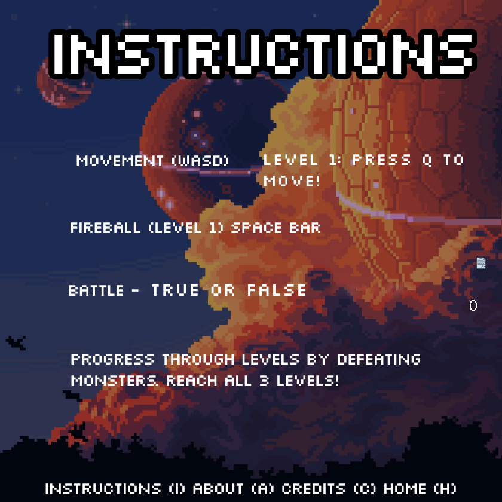
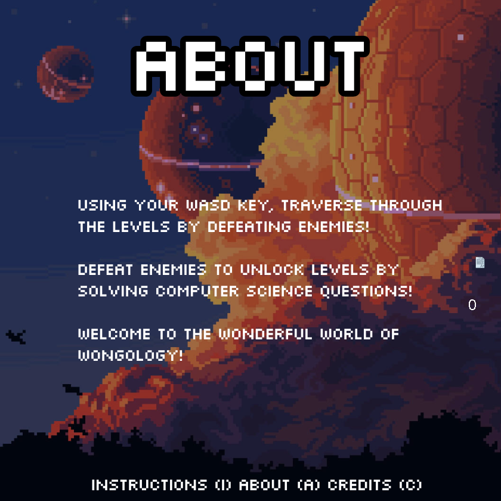
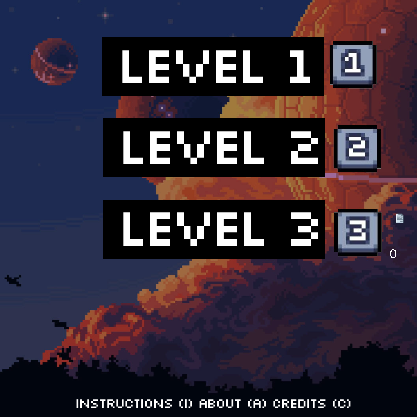
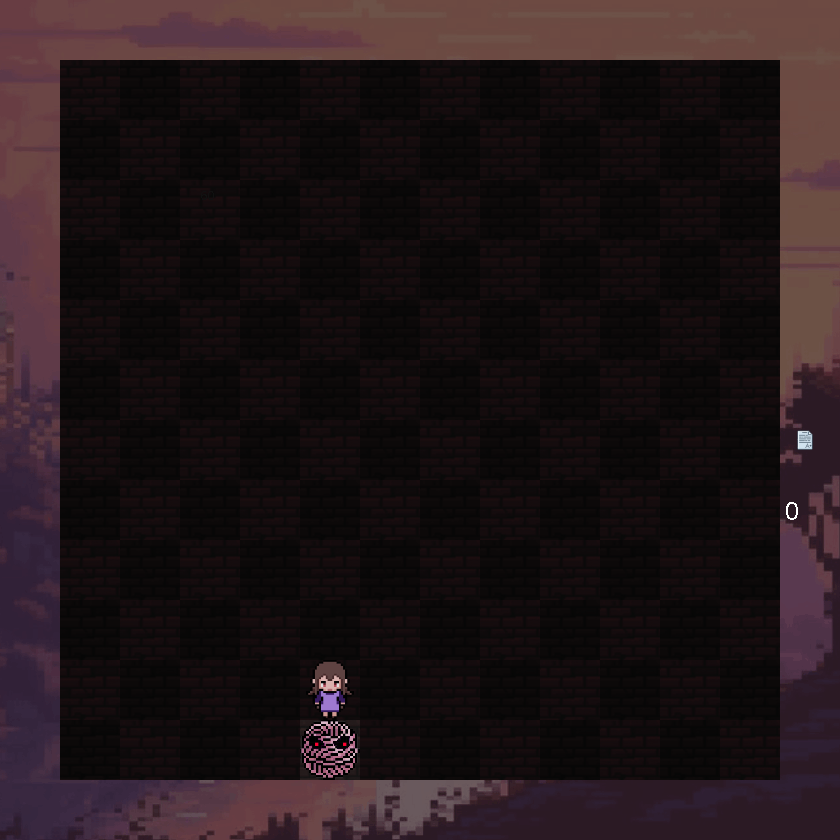
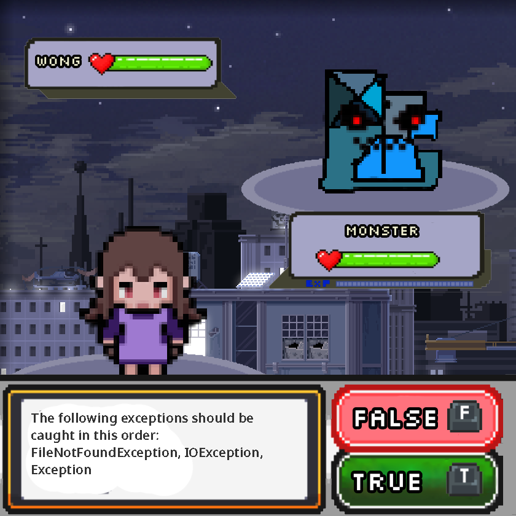
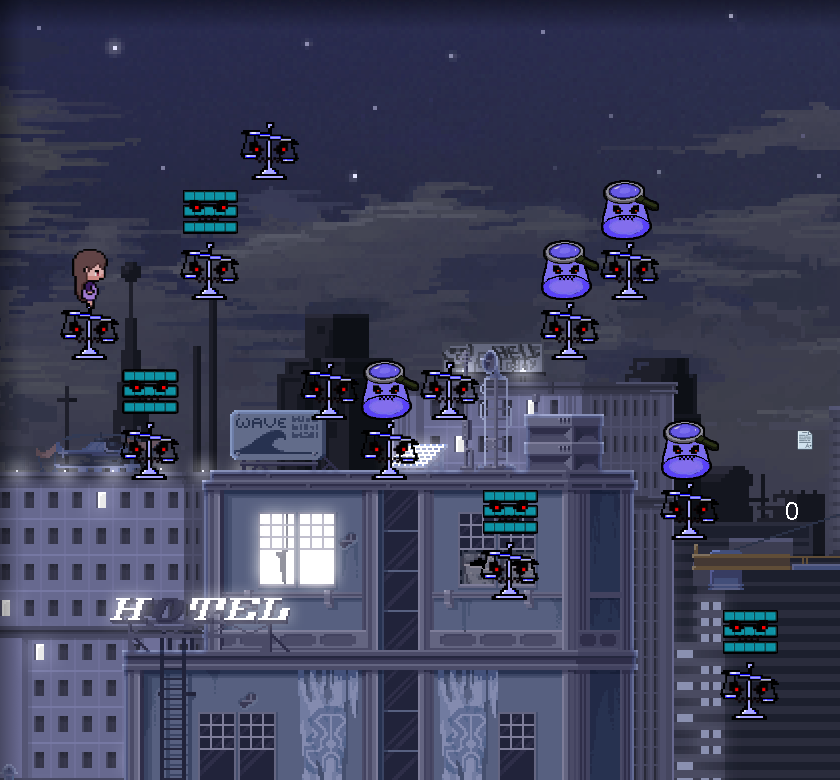
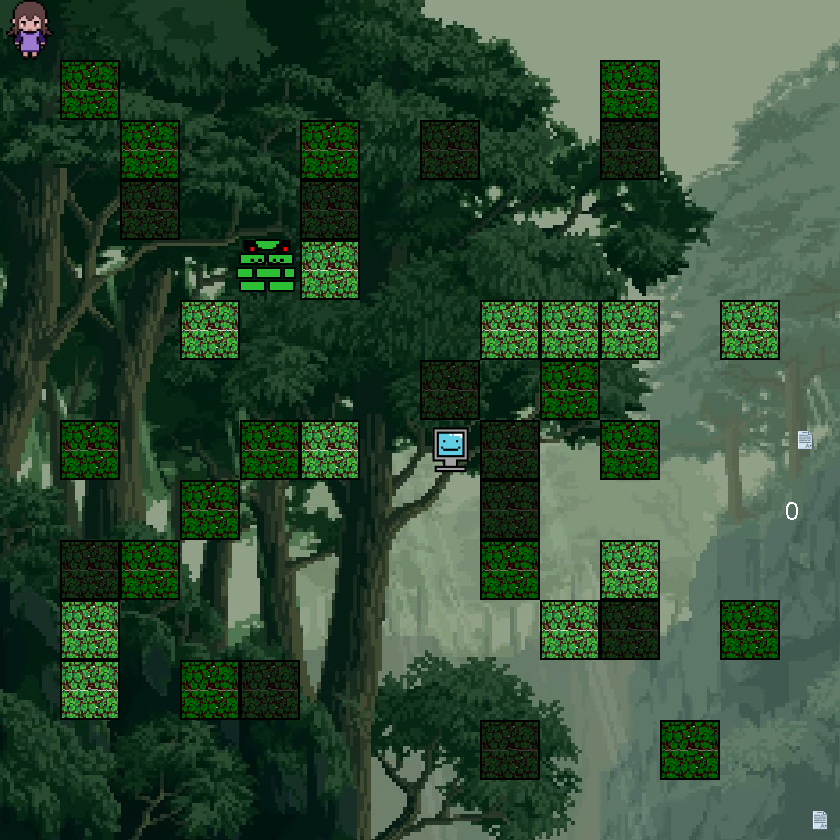
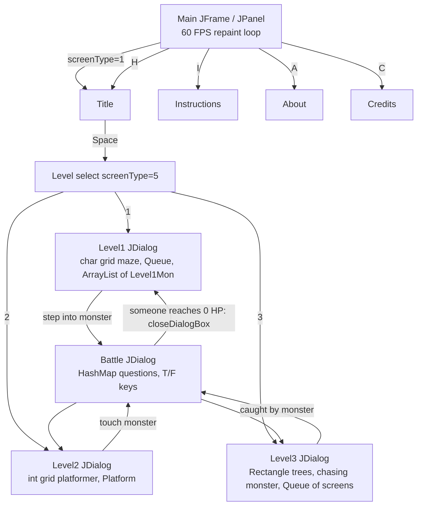

# Wongology
A pixel-art educational game, written in Java Swing, that teaches Java fundamentals, Object Oriented Programming, and Dynamic Data Structures. Made by Alex and Asvin.

You play as **Wong** and go through three levels full of "computer science monsters". Bumping into a monster starts a battle, and you fight it by answering true/false questions about Java.

## Screenshots

| Title screen | Instructions |
|---|---|
|  |  |
| **About (shown when you press C)** | **Level select** |
|  |  |
| **Level 1: dark maze** | **Battle (true/false question)** |
|  |  |
| **Level 2: rooftop platformer** | **Level 3: forest chase** |
|  |  |

## How to run
Requires Java 17 or newer (JDK). From the repository root:

```bash
javac -d out $(find src -name '*.java' -not -path '*legacy*')
java -cp out codeFiles.Main
```

On Windows PowerShell:

```powershell
javac -d out (Get-ChildItem -Recurse src -Filter *.java | Where-Object { $_.FullName -notmatch 'legacy' } | ForEach-Object { $_.FullName })
java -cp out codeFiles.Main
```

Run the game from the repository root so it can find the `assets` folder. Press spacebar on the title screen to start.

## How to Play

### Menus (main window)
| Key | Action |
|---|---|
| `Space` | From the title screen, go to the level select |
| `1` / `2` / `3` | On the level select, open Level 1, 2 or 3 in a new window |
| `I` | Instructions screen |
| `A` | About key (in the current build, this key shows the level menu artwork) |
| `C` | Credits key (in the current build, this key shows the "About" artwork) |
| `H` | Back to the title screen |

Each level opens in its own modal window, and battles open in another window on top of that. To give a window keyboard focus, click it.

### Level 1: dark maze (`W`/`A`/`S`/`D` + `Q`)
- The board is a 14×14 grid (`char[][]`). Wong starts in the top-left corner. Five monsters (String, File, Exception and Binary monsters) are placed at random hidden squares.
- The room is dark, so you can only see the square directly in front of Wong.
- Press `W`/`A`/`S`/`D` to **turn**, then press `Q` to **step** one square in that direction.
- When you step into a square that has a monster, a battle starts and the monster is removed from the board.

### Level 2: rooftop platformer (`A`/`D` to run, `W` to jump)
- Platforms are generated at random, one per column, using a stepped up/down pattern. Each platform has a 50% chance of getting a monster on top (ArrayList, Binary Search, Comparator or an unknown monster).
- The game has gravity and jumping. If you run off the right edge, the level regenerates. If you fall to the bottom, the level regenerates with one of four random backgrounds.
- Touching a monster opens a battle and costs one of your 3 lives, then the screen regenerates.

### Level 3: forest chase (hold `W`/`A`/`S`/`D`)
- 40 trees are placed at random and act as walls. The screen wraps around at the edges.
- A tree monster slowly chases Wong. If it catches you, a battle starts and the forest is regenerated.
- Reach the computer in the middle to score a point and move to the next forest background. The four backgrounds cycle through a `Queue`.

### Battles
- A Java question appears in the text box. Press `T` for **True** or `F` for **False**.
- A correct answer takes one heart from the monster. A wrong answer takes one heart from Wong. Both start with 4 hearts.
- The battle window closes when either side reaches 0 hearts. `W` is a developer cheat that damages the monster without answering.
- The question bank covers BufferedReader/Scanner, PrintWriter, exception ordering, binary and two's complement, integer ranges, and StringBuilder.

### Scoring
The mark counter on the right side of every screen shows `Level1.lvl1Points + Level2.lvl2Points + Level3.lvl3Points`.

## How It Works

### Architecture
- **`Main`** is the entry point. It is a `JPanel` that implements `Runnable` and `KeyListener`, and it lives inside a `JFrame` titled "Wongology". Its constructor starts a `Thread`, and `run()` loops `repaint()` + `Thread.sleep(1000 / FPS)` with `FPS = 60`.
- **Screen state machine:** the static `int screenType` decides which full-screen image `paintComponent` draws: 1 = title, 2 = instructions, 3 = about, 4 = credits, 5 = level select, 6 = game over. `keyPressed` changes `screenType`. Keys `1`–`3` on the level select create a modal `JDialog` that holds a new `Level1`, `Level2` or `Level3` panel.
- **`Level1`, `Level2`, `Level3`** have the same structure as `Main`: each is a `JPanel` + `Runnable` + `KeyListener` with its own 60 FPS thread that runs `move()/update()` and then `repaint()`. Each level opens a `Battle` in another modal `JDialog`, and `Battle` closes that dialog through the level's static `closeDialogBox("battle")`.
- **`Battle`** is a `JPanel` that draws the battle background (chosen by `Main.monsterType`), the player and monster health bars (images for 1–4 hearts) and the current question, wrapped to fit the box with `FontMetrics`.
- **`Level1Mon`** is a small monster model (`x`, `y`, `type`) that implements `Comparable<Level1Mon>`. Monsters are sorted by x and then y, and `equals` compares positions.
- **`Platform`** (in `Level2.java`) is a simple x/y holder for generated platforms.
- `src/codeFiles/legacy/` contains an older battle prototype. It is left out of the build.

### Data structures actually used
| Structure | Where | Purpose |
|---|---|---|
| `char[][]` grid | `Level1.gameArr`, `Level3.gameArr` | Maze map: `X` wall, `A` empty, `W` Wong, `S/F/E/B` monsters, `T` trees |
| `int[][]` grid | `Level2.screen` | Platformer tiles: 0 empty, 1 platform, 2–5 monster types |
| `Queue<String>` (`LinkedList`) | `Level1.monQueue` | Rotates through monster types while spawning |
| `ArrayList<Level1Mon>` + `Collections.sort` | `Level1.monsterList` | Monster list kept sorted by `compareTo` |
| `Queue<Integer>` (`LinkedList`) | `Level3.screenQueue` | Cycles through the 4 forest backgrounds |
| `HashMap<String,String>` | `Battle.Level1Questions` etc. | Question → `"T"`/`"F"` answer. A copy is made per battle, and each question is removed after it is asked |
| `Rectangle` / `Rectangle[]` | `Level2`, `Level3` | Hitboxes for the player, trees, monster and computer, using `intersects` |

The game does not use binary search or a custom `Comparator` class. These appear only as monster themes and artwork.

### Physics and collision
- **Level 2:** vertical speed `airSpeed` grows by `gravity` every frame, and a jump sets it to `jumpSpeed`. `CanMoveHere` checks the four corners of the player's hitbox against platform tiles in the grid. Battles are triggered by the tile under the player's top-left corner.
- **Level 3:** `checkCollision` resolves overlaps between Wong and each tree by pushing Wong out along the side with the smallest overlap. The monster moves toward Wong on both axes every frame.

### Assets and audio
- Images are loaded with `Toolkit.getDefaultToolkit().getImage(...)` from paths relative to the repository root (`assets/ui`, `assets/level1`, `assets/level2`, `assets/level3`, `assets/battle`). A `MediaTracker` `waitForAll()` makes sure they have loaded before the first draw.
- Background music is `assets/BackgroundMusic.wav`, played through `javax.sound.sampled` (`AudioSystem.getAudioInputStream` → `Clip`). If the file is missing or there is no audio device, the game prints a message and starts without music.

### Class and screen flow


### Known limitations (current code)
- No code path sets `screenType = 6`, so the Game Over screen can't be reached.
- `Main.points` is recalculated on every repaint from the three level counters, and nothing currently increments those counters. Because of this, the score shown on screen stays at 0, and Level 3's `Main.points += 1` is overwritten on the next frame.
- `Battle` fills only `Level1Questions`. Level 2 reuses that bank, but `Level3Questions` is empty, so a Level 3 battle opens a blank window (`NoSuchElementException`). If a battle goes past 12 questions, the same thing happens.
- The `A` (About) and `C` (Credits) screens use swapped/placeholder artwork. Level 2's heart image is never loaded, so lives aren't drawn.
- Level windows don't have their own close key. Close them with the window manager.

## Credits

- **Background music:** "Level 1" from *5 Chiptunes (Action)* by Juhani Junkala (SubspaceAudio) — https://opengameart.org/content/5-chiptunes-action — License: CC0 (public domain). Converted to 22050 Hz 16-bit stereo WAV.
